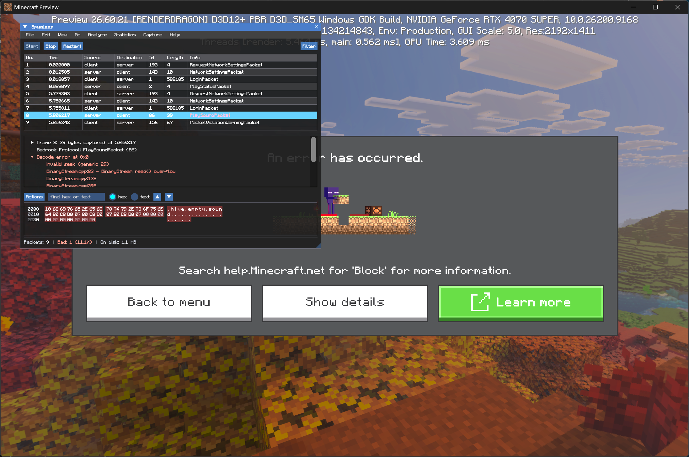
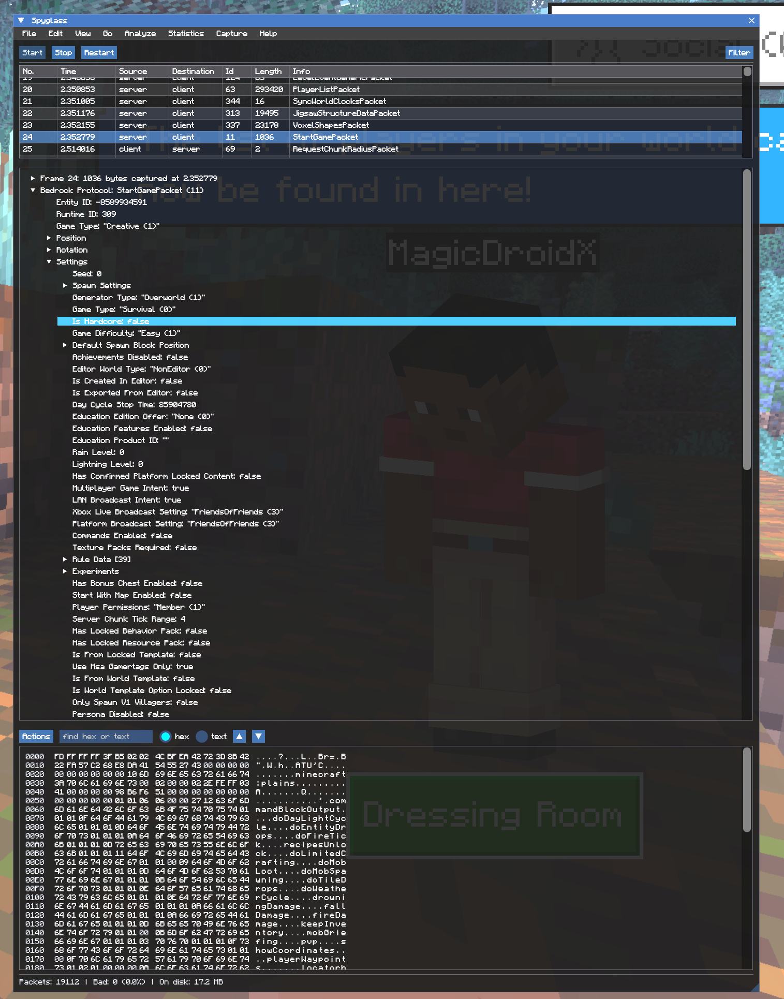

<p>めっちゃAI使ってるよ！ｗ</p>
<div align="center">
  

<h3>Spyglass JSモジュール</h3>

<p>
  <b>Minecraft: Bedrockクライアント内部で動作するパケットキャプチャ</b><br>
  クライアントが送受信するすべてのパケット、および読み取りに失敗したパケットについては、どこで中断し、なぜ失敗したのかを表示します。
</p>

[](https://github.com/remiria1315/spyglass-js-module/actions/workflows/ci.yml)
[-black)](https://www.minecraft.net/en-us/download)
[](LICENSE)
soygrass [](https://discord.gg/xxgPuc2XN9)

</div>



## 機能概要

**一覧 (List)** — セッション内のすべてのパケットを古い順に表示します：方向、ID、長さ、名前。リストからスクロールして離れるまで、末尾（最新）に追従します。デコードに失敗したものは色分けされます。

**詳細 (Details)** — フレーム、パケット、およびクライアント自身のシリアル（cereal）リフレクションからデコードされたフィールド（名前、値、列挙型名、ネスト構造を含む）を表示します。NBTを保持するフィールドはタグツリーとして開きます。失敗時には、クライアントがスローしたエラー、停止するまでに処理できたフィールド、およびファイル名と行番号まで遡ったBedrockのコールスタックが表示されます。



*クライアント自身のシリアルリフレクションによって命名、型付け、ネストされた `StartGamePacket` のすべてのフィールド。*

**バイト (Bytes)** — ボディを1つの16進数（ヘックス）の連続として表示し、デコード処理が到達しなかった部分は色を変えて表示します。両方の半面でクリック、ドラッグ、Shift+クリックによる範囲選択が可能で、`Ctrl+F` や `F3` を使ったヘックスまたはテキストの検索、さらに16進数ダンプ、16進数ストリーム、出力可能なテキスト、C言語の配列、Base64としてのコピーが行えます。「テキストを表示...（Show text...）」を使うと、クリップボードではなくボックス内に同じ出力が表示されます。

**フィルター (Filter)** — ツールバー上にあり、クライアントが認識しているすべてのパケットをIDごとに、チェックボックスおよび検出回数とともに表示します。「すべて（All）」「なし（None）」「反転（Invert）」が機能する検索ボックス、「デコード失敗のみ（Failed decodes only）」、および方向ごとのボックスがあります。リスト内のパケットを右クリックすると、非表示にしたり、そのパケットのみを表示したりできます。フィルターが有効な間は、ボタンにマークが表示されます。

**キャプチャ (Capture)** — `Start`、`Stop`、`Restart`。送信パケットおよび受信パケットに対応し、長さの制限はありません。一時的なものであり、クライアントの終了とともに消滅します。クラッシュしたクライアントに残されたデータは、次回のインジェクト時にクリーンアップされます。「キャプチャ ＞ オプション（Capture ▸ Options）」から、使用可能なメモリの設定や送信パケットのキャプチャ無効化を行えます。ステータスバーには、合計数、失敗の割合、選択範囲の広さ、表示されているパケット数、キャプチャのサイズ、およびゲームの進行を妨げないために破棄されたパケット数が表示されます。

**メニュー**（ショートカットキーは割り当てられていません）：

- `Go` — パケット番号、最初または最後、次のデコード失敗、同種の次のパケット、および閲覧履歴の戻る・進む。
- `Edit` — 名前、ID、またはボディ内のヘックス・テキストによる検索、パケットへのマーク付け、クロックのゼロ点設定、行・詳細ツリー・表示中の全行のテキストまたはCSV形式でのコピー。
- `View` — ペインの非表示、ズーム、ツリーの展開、色分けの無効化、カラム幅の調整、個別のウィンドウでのパケット表示、および「時間（Time）」の基準設定（最初のパケットからの経過時間、直前のキャプチャパケットからの経過時間、直前の表示パケットからの経過時間、または時刻）。
- `Analyze` — 失敗したデコードをクライアントのエラー理由と読み取っていたパケットごとにグループ化して表示（クリックでジャンプ）、および選択したバイトを整数、浮動小数点数、可変長整数（varint）、テキストとして読み取り。
- `Statistics` — セッションのキャプチャ内容、IDごとのバイト数の割合の内訳、パケット長の分布、および1秒あたりのパケット数またはバイト数のグラフ。
- `File` — `Export Packets...`（すべてのパケット、選択したパケット、マークされたパケット、または範囲指定したパケットを、キャプチャ全体またはフィルター表示中のみを対象とし、サマリー行、詳細ツリー、バイト表現を任意の組み合わせでテキスト、CSV、JSON形式でエクスポート）。件数のカウントとサイズ見積もりの後、ゲームを停止させることなく、キャンセル可能なプログレスバーの裏で実行されます。`Export Selected Packet Bytes...` は選択範囲の生データ（未選択時はボディ全体）を書き出します。`Export Session Summary...` は合計値を書き出します。

保存ダイアログは `%LOCALAPPDATA%\spyglass`（Linuxランチャーの場合は `~/.local/share/spyglass`）で開き、現在のディレクトリを表示し、フルパスの直接入力を受け付け、ファイルを上書きする前に警告を表示します。

---

## モジュール

JavaScriptモジュールは、内蔵されたQuickJSを通じてクライアント内部で実行されます。モジュールはどちらの方向のパケットも購読でき、クライアントがデコードしたフィールドや生データを読み取ることができるほか、クライアントが送信しようとしているパケットを破棄（キャンセル）したり、パケットのボディを置き換えたりすることができます。

```js
import { packet, Packets } from "spyglass";

packet.subscribe(Packets.textPacket, (pkt, ctx, cancel, override) => {
  cancel();
}, { direction: "c2s" });
```
[詳細はこちら](docs/modules.md)
